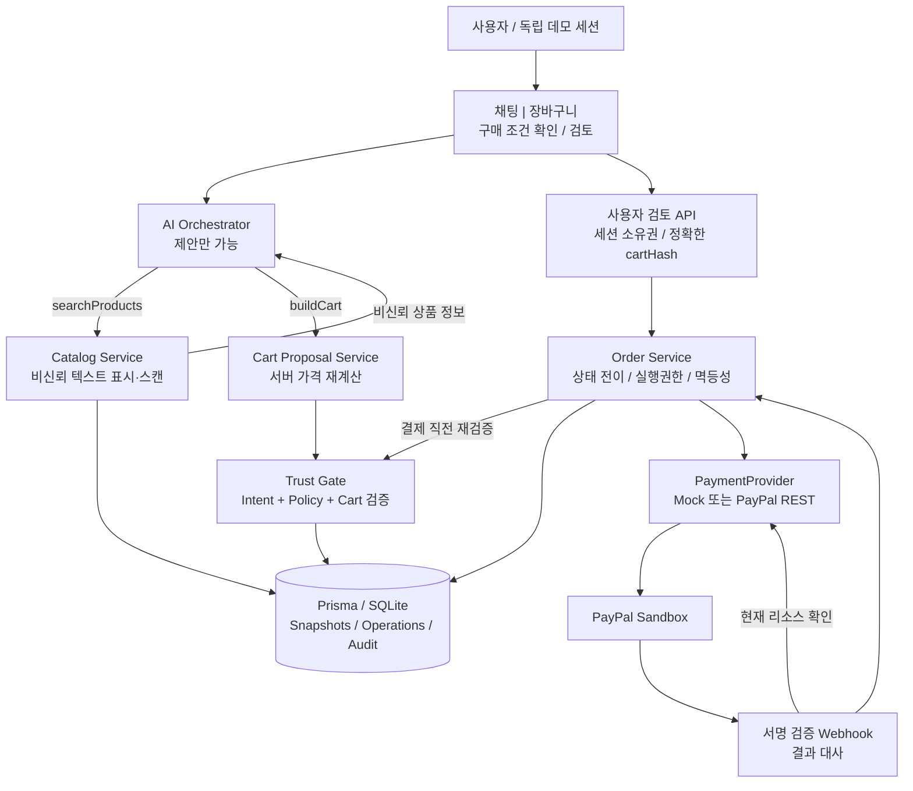
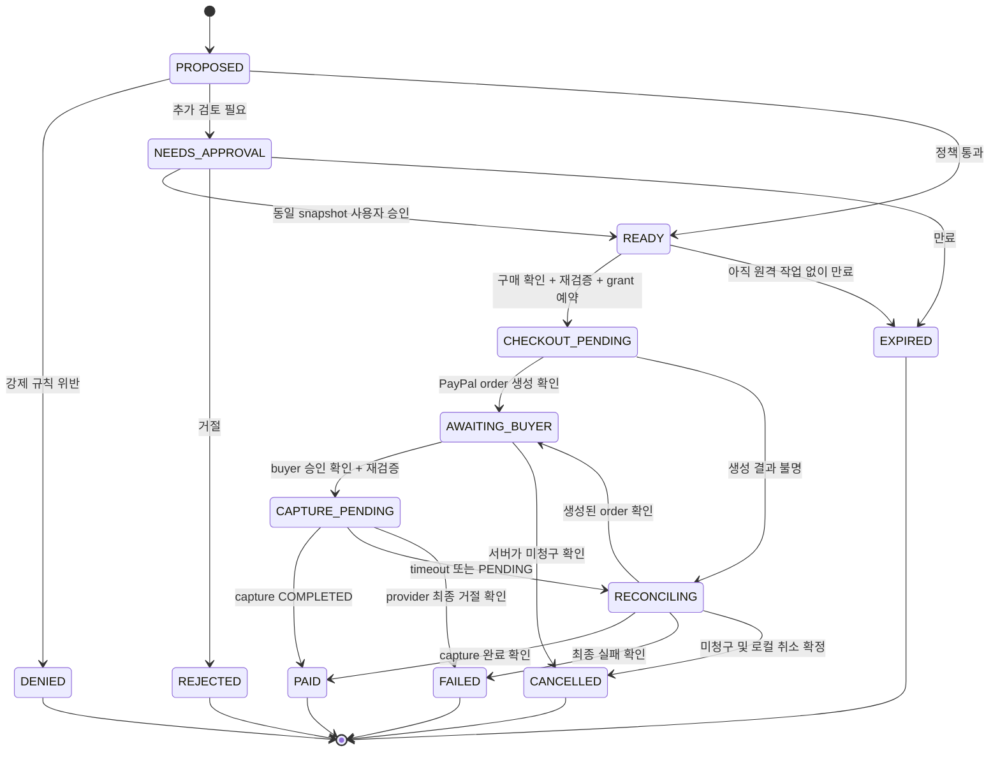
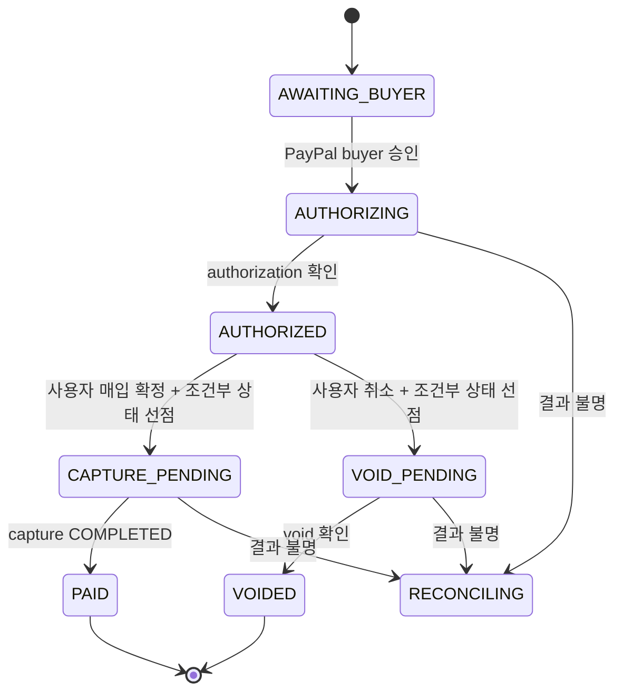

# TrustCart Agent — 설계 검토안 v0.1

작성: 2026-11-04 KST  
상태: **PROPOSED — 사용자 결정 전. 구현 착수 승인이나 최종 설계가 아니다.**

이 문서는 아키텍트, 보안 리뷰어, PayPal 전문가, 해커톤 심사위원, UX 디자이너의 검토를 통합한다. 동시 작업 제한으로 아키텍트 검토를 종료한 작업자에게 UX 검토를 별도 과제로 배정했다. 다섯 관점의 근거와 충돌 해결은 [DECISIONS.md](DECISIONS.md)에 기록했다.

이번 작업에서는 애플리케이션 코드를 수정하지 않았다. 앞선 요청에서 생성된 파일은 미완성 초안이다. 의존성 설치는 종료했고, 설치 완료·빌드·테스트 통과를 확인하지 않았다. 현재 코드를 설계의 정답으로 취급하지 않는다.

## 0. 추천하는 제품 한 문장

**AI가 구매 후보를 선택하되, 사용자가 확인한 구매 조건과 서버 정책을 통과한 장바구니만 PayPal 결제로 진행한다.**

영문 피치: **“AI chooses. Your rules authorize.”**

핵심 시연은 두 가지다.

1. 악성 상품 설명 또는 잘못된 AI 제안이 구매 조건을 바꿔도 서버가 결제를 막는다.
2. 정상 제안은 실제 PayPal sandbox capture까지 완료되고, 승인한 내용과 거래 금액을 대조할 수 있다.

추천 기본안은 **사람이 마지막 구매를 확인하는 보조형 agentic commerce**다. 자율성은 검색·비교·조합·제약에 맞춘 재계획에서 보여준다. 무인 결제, 완전한 인젝션 방지, AP2 인증 제품으로 발표하지 않는다.

### 확인된 제출 조건과 수정 사항

- 공식 마감: **2026-11-12 12:00 PST = 2026-11-13 05:00 KST**.
- PayPal sandbox와 AI를 의미 있게 통합해야 한다.
- 공개 소스 저장소와 오픈소스 라이선스가 필요하다. MIT를 유지한다.
- 동작 데모 접근이 필요하다. **배포 URL 자체가 강제되는 것은 아니며 완전한 빌드·실행 안내도 허용된다.** 다만 이번 프로젝트는 사용자 요구대로 배포 URL을 목표로 한다.
- 영상은 공개 YouTube에 올리고 **3분 미만**, 실사용 화면을 포함한다.
- 제출 자료는 영어 또는 영어 번역이 필요하다. 영어 UI·README·영상 자막을 우선한다.
- 다섯 심사 기준은 동등 가중이다. 페이지의 약 2만 8천 명은 참가자 수이며 출품작 수가 아니다.

근거: [공식 규칙](https://paypalaihackathon.devpost.com/rules), [대회 홈페이지](https://paypalaihackathon.devpost.com/). 심사 전략과 일정의 성공 가능성은 아래 작성자의 판단이며 보장하지 않는다.

### 설계 가정 — 아직 사용자 미확정

- 하루 집중 개발 6–8시간, 7일 총 42–56시간. 이보다 짧으면 P0도 추가 축소한다.
- USD만, 실제 수취인은 단일 sandbox merchant, 단일 purchase unit, 한 주문 전액 한 번 capture.
- 상품의 seller는 모의 카탈로그 공급자 속성이다. 실제 다중 판매자 결제·분할 정산은 아니다.
- 실물 배송·세금 계산·환율·재고 예약은 제외. 데모 가격은 배송/세금 0을 명시하고 PayPal 금액과 정확히 맞춘다.
- 신뢰할 수 있는 서버 관리 카탈로그의 가격·sellerId·category를 검증 기준으로 삼는다. 판매자 텍스트는 신뢰하지 않는다.
- 공개 방문자는 서로 독립된 익명 데모 세션을 사용한다. 실제 사용자 인증·장기 계정은 범위 밖이다.
- 추천 배포는 Render 유료 단일 인스턴스 + 영속 디스크 + SQLite. 비용 동의 전에는 확정하지 않는다.
- 첫날 PayPal Developer Dashboard에 접근하고 sandbox 자격증명을 확보할 수 있는지 검증한다.

## 1. 기획의 약점과 리스크 Top 5

| 순위 | 약점 / 실패 방식 | 근거와 영향 | 개선 |
|---|---|---|---|
| 1 | 8개 기능을 모두 핵심으로 잡고 PayPal을 마지막에 연결 | 의미 있는 PayPal 통합이 제출 조건이다. 타이머·authorize·void·refund·재시도·일일 예산이 서로 다른 실패 상태를 만든다. 7일 솔로에서는 완성도 손실이 큼 | Day 1 실제 sandbox capture 확인. P0는 capture 한 경로, 공격 차단 한 경로. 자동 지연 결제·refund는 제외 |
| 2 | 잘못 추출한 의도를 서명하면 정확해진다고 오해 | 서명은 서명 주체와 내용 변경 여부를 검증할 뿐, 자연어 이해나 사용자 동의의 정확성을 보장하지 않음. 현재 AP2 v0.2 명세는 Checkout/Payment Mandate를 정의 | 사용자가 구조화된 조건을 확인. 자체 Intent/Cart 모델은 AP2-inspired로 명시. Ed25519는 P1 |
| 3 | 스캐너·untrusted 태그·동일 턴 결제 금지에 안전성을 의존 | 분류기·패턴은 우회/오탐 가능. 공격 정보는 다음 턴에도 남을 수 있음. 정답 라벨 isMalicious로 차단하면 평가가 순환적 | LLM에 결제 권한 없음. 결정적 서버 검증을 모든 결제 진입점에 적용. 정답 라벨은 평가 전용 |
| 4 | 정책 검사와 일회용 토큰만으로 중복 결제·변경된 승인 문제를 해결했다고 가정 | 동시 요청, timeout 뒤 재시도, 정책 변경, cart 변경, 웹훅 재전송에서 우회 가능 | 불변 cartHash와 승인 결합, 조건부 상태 변경, 영속 PaymentOperation, 원격 결과 대사, 소유권 검사 |
| 5 | 배포·신뢰 증거가 시연 단계에서 깨짐 | Vercel 로컬 SQLite는 영속 DB가 아님. 단순 해시 체인은 DB 전체 재작성에 약함. 자체 10개 예제로 일반 탐지율을 주장할 수 없음 | Render 영속 디스크 또는 별도 DB 선택. “데모셋 결과”와 “결제 차단 결과” 분리. 해시 체인의 위협 범위 명시 |

근거: [AP2 현재 명세](https://ap2-protocol.org/ap2/specification/), [Invariant 가드레일](https://raw.githubusercontent.com/invariantlabs-ai/docs/main/docs/mcp-scan/guardrails-reference.md), [PayPal 멱등성](https://developer.paypal.com/api/rest/reference/idempotency/), [Vercel SQLite 설명](https://vercel.com/kb/guide/is-sqlite-supported-in-vercel), [Render 영속 디스크](https://render.com/docs/disks).

**가장 중요한 설계 변경:** “무엇을 살지 잘 이해했는가”와 “돈을 움직일 권한이 있는가”를 별도로 검증한다. 취향·품질·상품 적합성의 의미적 정확성 전체를 서버가 보장한다고 주장하지 않는다.

## 2. 개선된 아키텍처와 데이터 모델

### 2.1 실행 구조

단일 Next.js App Router/TypeScript 앱, Tailwind, Vercel AI SDK, Prisma. 별도 Spring 백엔드·마이크로서비스·메시지 브로커는 만들지 않는다.

**그림은 런타임 흐름이다. 코드 import 방향은 별도로 제한한다.**

- routes/UI → application services.
- application → 순수 domain 규칙 + 필요한 infrastructure.
- domain은 React, Prisma, SDK, HTTP, LLM을 import하지 않는다.
- agent 모듈은 catalog와 cart 제안만 사용한다. payment, approval mutation, policy mutation을 import하지 않는다.
- PayPal SDK/REST와 secret은 server-only payment infrastructure에만 둔다.
- webhook은 임의의 event 본문을 주문 상태로 복사하지 않고, 검증 후 대사 서비스를 호출한다.
- 범용 repository 계층은 만들지 않는다. Prisma 접근은 적은 수의 server service에 모으고 정책 계산에 값만 전달한다.
- PaymentProvider는 실제 두 구현(Mock/PayPal)을 위해서만 둔다. 범용 결제 플랫폼으로 확장하지 않는다.

예상 모듈: `src/domain/{intent,policy,cart,order}`, `src/server/{agent,catalog,orders,approvals,audit,payments}`, `app/api/*`. 최종 파일명은 첫 작업에서 기존 파일과 대조해 확정한다.

### 2.2 구매 조건과 서버 정책

LLM은 요청을 구조화한 **초안**만 만든다. 첫 구매 작업에서 다음 항목을 사용자가 확인한다.

- USD 총예산.
- 요청한 상품 종류와 수량. 분류가 모호하면 물어보거나 검토 사유로 표시.
- 금지/허용 카테고리와 판매자.
- 명시적 제외 조건.
- 만료 시간. 데모 기본값은 UI에 보이는 제안으로 제시한다.

확인 후 불변 IntentMandate를 만든다. 일반 대화나 설명 질문마다 다시 확인하지 않는다. 예산·수량·허용 범위 변경 때만 새 버전을 확인한다. LLM이 사용자 동의를 대신하거나 기존 mandate를 수정할 수 없다.

판정 우선순위:

1. **DENY:** 소유권·만료·예산·수량·금지 카테고리·판매자·재고·스냅샷 무결성 등 강제 제약 위반.
2. **NEEDS_APPROVAL:** 강제 제약은 통과했지만 승인 기준 금액 이상이거나 의미적 적합성을 확인해야 함.
3. **ALLOW:** 정책 통과. 자동 청구가 아니라 PayPal checkout 진행 가능이라는 뜻.

DENY는 “그래도 승인”으로 풀지 않는다. 조건을 명시적으로 변경하고 새 mandate/cart로 평가하거나 장바구니를 다시 구성한다. 불일치 점수 합산은 제거하고 `ruleId / expected / actual / outcome`으로 설명한다.

**최종 구매 확인은 항상 존재한다.** ALLOW 주문은 장바구니에서 “PayPal로 계속”을 누르며 현재 cartHash를 확인한다. NEEDS_APPROVAL 주문은 같은 내용에 대해 승인함에서 명시적 검토를 기록한 뒤 계속한다. 앱의 확인은 PayPal 구매자 승인과 다르다.

### 2.3 최소 데이터 모델

금액은 DB·도메인에서 정수 USD cents. JSON seed의 `priceUSD`만 입력 형식이며, 초기화 시 정수 변환·범위 검증한다. 주요 JSON payload는 Zod로 검증한다.

| 모델 | 필수 필드 | 불변식 |
|---|---|---|
| DemoSession | id, createdAt, expiresAt | 서버 발급 HttpOnly/Secure/SameSite 쿠키. 모든 조회·변이의 소유권 조건 |
| Product | id, name, categoryId, priceCents, stock, sellerId, description, catalogVersion | 가격·sellerId·categoryId는 서버 관리. name/description은 비신뢰 텍스트 |
| PolicyVersion | id, sessionId, version, maxOrderCents, approvalThresholdCents, blockedCategoryIds, allowedSellerIds, createdAt | 수정 대신 새 버전. threshold는 hard cap 이내 |
| IntentMandate | id, sessionId, originalRequest, schemaVersion, constraintsJson, budgetCents, currency, confirmedAt, expiresAt, canonicalHash | 확인 후 수정 불가. 변경은 새 mandate. signature/keyId는 P1 nullable |
| Order | id, sessionId, intentId, policyVersionId, status, cartSnapshotJson, cartHash, totalCents, currency, evaluationJson, version, expiresAt, timestamps | cartSnapshot은 상품 ID·수량·단가·판매자·카테고리·표시명을 포함. 변경하면 새 Order 생성 |
| Approval | id, sessionId, orderId, cartHash, intentHash, policyVersionId, decision, decidedAt | 현재 정책·동일 snapshot에만 유효. 사용자 route만 작성 |
| BudgetGrant | id, orderId UNIQUE, intentId, cartHash, maxCents, currency, expiresAt, status | 주문 단위 내부 실행권한. LLM·브라우저에 bearer token으로 노출하지 않음 |
| PaymentOperation | id, orderId, operation, logicalKey UNIQUE, requestId UNIQUE, status, providerResourceId, requestFingerprint, errorCode, timestamps | 요청 전에 저장. 동일 논리 작업은 동일 PayPal-Request-Id. 결과 불명 상태 보존 |
| WebhookReceipt | providerEventId UNIQUE, receivedAt, verifiedAt, resourceId, processingStatus, processedAt | 중복 이벤트 멱등 처리. 미검증 이벤트는 상태 변경 금지 |
| AuditEvent | id, sessionId, orderId, sequence, actor, eventType, payloadJson, createdAt | 상태 변경과 함께 저장. (sessionId, sequence) UNIQUE. prevHash/hash는 P1 |

Order에는 `providerOrderId`, `captureId`, `providerStatus`를 추가한다. authorize/void를 채택할 때만 `authorizationId`, refund를 채택할 때만 `refundId`를 추가한다. 별도 CartMandate 테이블은 만들지 않고 Order의 불변 snapshot과 Approval이 해당 역할을 맡는다.

`isMalicious`는 원본 JSON 및 평가 fixture에 존재하되, **런타임 카탈로그 DTO·스캐너 입력·LLM 입력·차단 조건에 포함하지 않는다.** 운영 Product 테이블에 넣을 필요도 없다. 10개 정답 라벨은 평가 코드가 별도로 로드한다.

BudgetGrant 상태는 `AVAILABLE → RESERVED → CONSUMED`, 취소·만료 확정 시 `REVOKED`. 이중 호출로 AVAILABLE 권한을 두 번 예약할 수 없어야 한다. API timeout 때 AVAILABLE로 되돌리지 않는다. 성공 여부가 불명인 동안 주문과 권한을 보류한다.

P1 일일 한도를 넣는다면 `DailyBudget(sessionId, dateUTC, reservedCents, spentCents)`가 추가된다. `spent + reserved + requested ≤ limit`을 원자적으로 검사한다. refund로 한도를 복구하지 않는 규칙부터 시작한다. P0 UI에 일일 한도가 작동하는 것처럼 보이는 입력을 두지 않는다.

### 2.4 서명, 해시와 동의의 정확한 의미

P0는 canonical serialization + cartHash + 서버에 저장된 승인 바인딩이다. hash는 승인 대상을 식별하는 장치이지 서버 관리자 공격 방어가 아니다.

P1 Ed25519를 넣을 때:
- 서버의 표준 암호 라이브러리로 서명한다. 직접 암호 알고리즘을 구현하지 않는다.
- payload에 domain/type, schemaVersion, owner/session, mandate ID, nonce, issuedAt, expiresAt, currency, constraints를 넣고 직렬화 규칙을 고정한다.
- 개인키는 서버 secret, keyId와 공개키만 노출한다.
- **서버 발행 확인서**라고 설명한다. 사용자의 개인키 서명, 법적 동의 증명, AP2 준수라고 말하지 않는다.

현재 AP2 v0.2는 Checkout/Payment Mandate 및 비에이전트 Trusted Surface를 정의한다. 기존 Intent/Cart 명칭을 사용하더라도 로컬 설계 명칭임을 밝힌다. [현재 명세](https://ap2-protocol.org/ap2/specification/)

### 2.5 인젝션 방어와 평가

- description/name 같은 판매자 텍스트는 데이터로만 다룬다. raw HTML을 렌더링하지 않는다.
- 입력 길이 제한, Unicode 정규화 검사, 숨은/방향 제어 문자 탐지, 소수의 명확한 조작 패턴을 TS로 구현한다.
- 원문과 탐지에 사용한 정규화 버전을 구분한다. 모든 비ASCII 문자를 공격으로 취급하지 않는다.
- 의심 상품은 격리하고 사유를 표시한다. 통과한 텍스트도 계속 untrusted다.
- structured tool response와 untrusted 표시는 보조 수단이다. 핵심은 payment tool 자체가 없고 서버가 권한을 재검사한다는 점이다.
- “외부 정보를 읽은 턴에는 결제 금지” 대신 **모든 턴에서 LLM의 직접 결제·승인·정책 변경을 금지**한다.
- external URL fetching, arbitrary file access, arbitrary HTTP tools는 제공하지 않는다.

llm-guard의 ML PromptInjection scanner를 실제로 설치하지 않으면 “llm-guard 적용”이라고 표시하지 않는다. [PromptInjection](https://raw.githubusercontent.com/protectai/llm-guard/main/docs/input_scanners/prompt_injection.md), [InvisibleText](https://raw.githubusercontent.com/protectai/llm-guard/main/docs/input_scanners/invisible_text.md).

평가 화면은 다음 네 항목만 둔다.

| 측정 | 표시 방식 |
|---|---|
| 탐지 성능 | 고정 데모셋 10개에서 TP/FN, 정상 20개에서 FP/TN. 분모 표시 |
| 구매 권한 방어 | 금지된 상태 전이/checkout 시도 중 서버에서 차단된 수 |
| 정상 기능 보존 | 정상 요청이 장바구니·sandbox 결제까지 완료된 수 |
| 재현성 | 모델/프롬프트/규칙/fixture 버전, 시각, 실행 횟수 |

별도 holdout은 규칙 작성에 쓰지 않은 변형 공격 5개 이상과 정상 설명 5개 이상을 둔다. 다음 턴 우회, 한국어/영어 재표현, 숨은 문자, 가짜 system 역할, 승인 생략을 포함한다. 수치를 미리 넣지 않는다.

스캐너가 놓친 경우도 서버 검증이 막는 테스트를 만든다. 고정 악성 cart를 주입하는 회귀 테스트는 **서버 경계 테스트**라고 표시한다. 이를 실제 LLM이 자발적으로 공격에 넘어간 결과로 꾸미지 않는다.

## 3. 주문 상태 머신과 PayPal 대응

### 3.1 P0: intent CAPTURE, 승인된 장바구니 한 번 결제

RECONCILING은 자동 실패가 아니다. `PaymentOperation.operation`과 provider resource 조회 결과로 복구할 상태를 결정한다. 그림의 FAILED는 실패가 확정된 경우만 뜻한다. 재시도가 안전한지 모르면 새 checkout을 생성하지 않고 대사를 계속한다.

PayPal buyer 승인 이후 정책·가격이 바뀌면 capture하지 않는다. 미청구를 확인한 후 기존 checkout을 로컬에서 폐기하고 새 cart/승인을 요구한다. 이미 진행 중인 remote operation에는 EXPIRED를 덮어쓰지 않는다.

브라우저 redirect나 onApprove 자체는 결제 성공 증거가 아니다. **capture resource의 COMPLETED** 및 금액·통화·수취인·주문 바인딩 일치를 확인해야 PAID다. [capture 상태](https://developer.paypal.com/api/payments/v2/definitions/capture_status/)

### 3.2 P1: AUTHORIZE를 선택한 별도 주문의 확장

동일 주문에서 CAPTURE intent를 AUTHORIZE로 임의 전환하지 않는다. RECONCILING의 복구는 작업 종류에 맞게 provider 조회로 수행한다. P1은 수동 매입 확정으로 시작하며 자동 countdown capture는 구현하지 않는다.

정확한 엔드포인트:

| 작업 | API |
|---|---|
| 기본 주문 생성 | POST /v2/checkout/orders, intent=CAPTURE |
| 기본 capture | POST /v2/checkout/orders/{orderId}/capture |
| 확장 주문 생성 | POST /v2/checkout/orders, intent=AUTHORIZE |
| buyer 승인 후 authorize | POST /v2/checkout/orders/{orderId}/authorize |
| authorization capture | POST /v2/payments/authorizations/{authorizationId}/capture |
| 미매입 authorization 취소 | POST /v2/payments/authorizations/{authorizationId}/void |
| 매입 후 환불 — 이번 제출 제외 | POST /v2/payments/captures/{captureId}/refund |

authorize는 잔액 보류가 생길 수 있으며 “아무 일도 일어나지 않았다”가 아니다. 전액 capture 이후에는 void가 아니라 refund다. 통상 authorization은 29일 유효, 첫 3일 honor period이며 sandbox 만료는 실제 환경과 다를 수 있다. 이번 제출은 장기 authorization 시나리오를 다루지 않는다. [공식 가이드](https://developer.paypal.com/platforms/checkout/standard/customize/auth-capture/), [Honor period](https://developer.paypal.com/payment-methods/auth-honor/), [지연 capture](https://developer.paypal.com/checkout/delay-capture/).

AUTHORIZE는 여러 purchase_units를 지원하지 않는다. 단일 merchant/purchase unit 가정은 P0에도 유지한다. [Orders create](https://developer.paypal.com/api/orders/v2/orders-create)

### 3.3 paymentProvider와 agent-toolkit

P0 인터페이스 책임은 createCheckout, captureOrder, getOrder/getCapture, verifyWebhook에 한정한다. authorize/void/refund 메서드는 실제 채택 단계에만 추가한다.

공식 agent-toolkit의 현재 TypeScript captureOrder는 Orders capture 경로를 호출하며, 검토한 shared functions에는 authorization capture/void 전체 흐름이 없다. 따라서 “MockProvider를 toolkit으로 교체하면 끝”이라는 가정은 버린다. **얇은 서버 REST PayPalProvider**를 추천한다. PayPal을 LLM 도구로 노출할 필요도 없다. [공식 저장소](https://github.com/paypal/agent-toolkit), [검토한 구현](https://github.com/paypal/agent-toolkit/blob/main/typescript/src/shared/functions.ts).

### 3.4 중복, 대사, 웹훅

결제 시작 순서:

1. 소유권·승인 snapshot·현재 정책·권위 있는 가격·재고·만료 확인.
2. 짧은 DB transaction에서 조건부 상태 변경, BudgetGrant 예약, PaymentOperation 및 감사 이벤트 저장.
3. transaction 종료 후 PayPal 호출. 외부 HTTP 동안 DB 잠금을 잡지 않는다.
4. provider 결과 검증 후 별도 transaction에서 주문·권한·작업·감사 상태 저장.
5. timeout은 결과 불명으로 보존. 같은 논리 작업의 같은 request ID와 원격 조회로 복구.

유일 제약 `(orderId, operation, logicalVersion)`과 조건부 상태 변경을 함께 사용한다. PayPal 멱등키 저장 기간은 endpoint마다 다를 수 있으므로 무한 재시도를 가정하지 않는다. 보존 기간이 지난 결과 불명 작업은 새 키로 청구하지 않고 운영자 확인 상태로 둔다. [PayPal 멱등성](https://developer.paypal.com/api/rest/reference/idempotency/).

P0에 최소 웹훅을 포함하되 범용 이벤트 버스는 만들지 않는다.

- verify-webhook-signature로 검증하고 eventId로 중복 제거.
- 이벤트가 알려진 merchant/order에 대응하는지 확인.
- event 순서를 신뢰하지 않고 provider 현재 resource로 대사.
- 처리 실패 receipt는 영속 보존하고 관리자/상태 조회의 복구 경로에서 재처리.
- PAYPAL capture 완료가 local audit 오류 때문에 FAILED로 뒤집히면 안 된다.
- 실제 sandbox 거래의 webhook으로 통합 테스트한다. simulator 이벤트를 실제 검증 성공 근거로 삼지 않는다.

근거: [PayPal 웹훅 공식 문서](https://developer.paypal.com/api/rest/webhooks/rest/).

### 3.5 공개 데모의 최소 보안

- visitor별 서버 발급 세션, 주문/승인/정책/로그 소유권 검사. 임의 order ID 접근은 404 또는 403.
- mutation은 POST/PATCH, Origin 검증 및 CSRF 방어. callback/웹훅은 별도 검증 경로.
- 채팅 요청 길이, 메시지/도구 횟수, 세션/IP별 요청 한도와 전역 AI 비용 한도.
- AI·PayPal secret은 서버 전용. public repo·브라우저 번들·로그·프롬프트에 넣지 않는다.
- sandbox host와 merchant는 서버 설정으로 고정. 사용자가 임의 provider URL을 넣을 수 없다.
- 익명 방문자는 서로 다른 데모 정책을 변경할 수 있지만, hard server cap과 sandbox-only 설정은 바꿀 수 없다.
- 이 구조는 실제 결제 서비스의 인증·사기 방지·규제 준수 구현이 아니다. UI에 Sandbox를 명확히 표시한다.

## 4. 기능 우선순위

| 반드시 넣을 것 — P0 | 있으면 좋은 것 — P1 | 이번 제출에서 버릴 것 |
|---|---|---|
| 실제 AI 검색·비교·장바구니 재계획 | 서버 Ed25519 확인서와 검증 상세 | AP2 완전 준수/사용자 암호 서명 주장 |
| 30상품 / 10악성 평가 fixture | 단순 로그 해시 체인·export | 범용 불일치 점수/가중치 튜닝 |
| 사용자 확인 intent + 불변 cart | AUTHORIZE→수동 capture 또는 void | 자동 지연 capture·브라우저 알림 |
| 서버 결정적 예산·수량·카테고리·seller 정책 | 원자적 일일 예산 예약 | refund 시연, 부분 capture/refund |
| 승인 임계값과 승인함 | 추가 holdout·교차 모델 평가 | JWT 예산 토큰 플랫폼·범용 taint 엔진 |
| 주문별 내부 BudgetGrant | 고급 감사 필터 | 별도 llm-guard 서비스·다중 LLM |
| 최소 Unicode/패턴 경고 + 영구적인 LLM 결제 권한 분리 | 한국어 UI 번역 | 다중 merchant 실제 정산·배송/세금 |
| PayPal CAPTURE, 멱등성, 대사, 최소 verified webhook | 필요 시 관리형 DB로 전환 | 서버리스 로컬 SQLite·프런트 timer 청구 |
| 방문자 격리, 감사 타임라인, 작은 테스트 결과 화면 |  | 블록체인·외부 로그 앵커·키 회전 인프라 |
| 영문 UI/README, MIT, 배포, 2:50 영상 |  | 일반화된 “100% 탐지/변조 불가능” 주장 |

P1은 **Day 4 종료 시 P0 결제와 보안 회귀가 통과했을 때 하나만** 고른다. 추천은 authorize/void보다 설명 가능한 감사 타임라인 마감 품질을 먼저 높이는 것이다. 기술 차별화가 부족하다고 판단되면 수동 authorize/void를 선택한다. 여러 P1을 동시에 채택하지 않는다.

### 사용자 화면

상단 메뉴는 유지한다: Shop / Policies / Reviews / Activity / Security tests.

- 메인: 채팅 55%, 장바구니 45%. 모바일은 세로 배치.
- 정책: 1회 한도, 승인 기준 금액, 제외 카테고리; 허용 seller는 펼침 설정.
- 승인함: 승인 필요 사유 → 요청 대비 변경점 → 금액 → 정확한 cart 승인/거절.
- 감사 로그: 먼저 구매 타임라인. IDs/hash/원시 이벤트는 상세.
- 보안 대시보드: “Demo test results”로 명시. 점수판처럼 보이는 가짜 실시간 숫자는 금지.
- 알림: P0는 앱 내 “검토할 주문 1건” 정도. OS 알림 권한과 가짜 countdown은 넣지 않는다.

| 실제 상태 | 영문 사용자 문구 | 다음 행동 |
|---|---|---|
| 강제 제약 위반 | This cart doesn't match your purchase limits. | Revise cart / Edit purchase request |
| 추가 검토 필요 | This purchase needs your review. | Approve this cart / Reject |
| 앱 승인 완료 | Cart approved. You have not been charged. | Continue with PayPal |
| 결과 불명 | We're checking the payment result. A new payment is temporarily blocked. | Check status |
| capture 완료 확인 | Payment completed in PayPal Sandbox. | 금액·거래 ID·타임라인 |
| P1 void 완료 | Payment authorization cancelled. | 잔액 반영 시각은 단정하지 않음 |

공격 텍스트는 “의심 지시문”으로 표현하고 공격 확정·탐지 정확성은 실제 평가 근거가 있을 때만 말한다.

## 5. 7일 개발 계획

**가정:** 설계 확정 후 11/5–11/11 KST를 7일 작업일로 사용한다. 11/12는 예상치 못한 문제의 여유일이며 범위를 늘리는 날이 아니다. 실제 가용일에 맞춰 이동하되 마지막 날은 배포·영상·제출 전용이다.

| 날짜 / 단계 | 산출물 | 다음 단계로 넘어가는 증거 |
|---|---|---|
| Day 1 — 11/5 / 뼈대+결제 연결 검증 | repo/lockfile/MIT, Next 기본 화면, Prisma 초기화, 독립 세션, Render 조기 배포, PayPal sandbox buyer/seller 확인, 작은 정상 capture 스파이크 | 새 환경에서 설치·기동, 재시작 후 DB 유지, sandbox capture ID와 금액 확인. 단계 1 감사 기록 |
| Day 2 — 11/6 / Mandate 검증 | 요청 구조화·사용자 조건 확인·불변 intent/cart, ID 기반 서버 가격 계산, 정확한 cartHash 검토 | 변경된 수량/가격/통화·만료·타 세션 주문 거부 테스트. 단계 2 감사 |
| Day 3 — 11/7 / 정책 엔진 | ALLOW/NEEDS_APPROVAL/DENY, hard cap·수량·카테고리·seller·threshold, BudgetGrant 예약, PaymentOperation 멱등성 | 초과·중복 품목·동시 요청·stale policy 차단. 단계 3 감사 |
| Day 4 — 11/8 / 인젝션 방어 | 실제 AI 두 도구, 비신뢰 데이터 경계, Unicode/패턴 스캔, 10악성+holdout, 테스트 결과 최소 화면 | 정상 구매 제안 완성, 라벨 미사용 검사, 탐지 누락 시에도 권한 위반 차단. 단계 4 감사 + graphify 경계 검증 |
| Day 5 — 11/9 / 승인·앱 알림·감사 | 승인함, 조건 변경 시 재검토, pending/unknown UX, 사건 타임라인, 공개 demo rate limit | DENY는 승인 우회 불가, 타 방문자 접근 불가, reload 뒤 상태 복구. 단계 5 감사 + graphify 재생성 |
| Day 6 — 11/10 / PayPal 통합 마감 | Day 1 스파이크를 실제 주문 경로에 연결, verified webhook, pending/timeout 대사, 금액·merchant 검증 | 배포 환경 AI→정책→승인→PayPal capture E2E, 이중 클릭/웹훅 중복/순서 역전 테스트. 단계 6 감사. 기능 동결 |
| Day 7 — 11/11 / 배포·영상·제출 | 최종 배포 재현, 영어 README/영상/Devpost, 라이선스·secret 검사, 공개 repo와 2:50 영상 | 비로그인 브라우저에서 URL 접근, 심사자 재현 안내, 실제 제출 링크/상태 확인 |

단계 감사는 지정한 Cloudflare security-audit을 사용하고 결과·재현·조치·재검증을 [SECURITY.md](SECURITY.md)에 누적한다. Day 4/5 graphify는 “그래프 생성됨”만으로 통과하지 않는다. 금지 import edge를 검사하고 발견된 위반을 기록한다.

각 날짜의 작업에는 감사/수정 시간을 포함한다. 감사 도구 설치나 격리 환경이 준비되지 않으면 **감사 미실행**으로 기록하고 다음 단계 통과로 간주하지 않는다. 지정 도구를 다른 리뷰로 대체할지는 사용자 결정 사항이다.

### 중단·축소 기준

- Day 1 전반: Developer Dashboard 접근 불가면 즉시 계정 문제를 최우선 blocker로 표시한다. live KYC와 sandbox 접근을 구분해 확인한다.
- Day 2 종료까지 실제 sandbox capture가 없으면 P1 전부 동결하고 PayPal 연결 문제부터 해결한다.
- Day 3에도 자격증명을 확보하지 못하면 Mock 개발은 가능하지만 제출 요건 충족을 주장할 수 없다. 문의 메시지는 사용자 승인 없이 발송하지 않는다.
- Day 4 P0가 미완료면 signature, hash chain, authorize/void, 일일 한도는 이번 제출에서 제거한다.
- Day 6 미해결 금액/권한/이중 결제 결함은 P0 blocker다. 영상으로 숨기지 않는다.
- 배포는 Day 1부터 시험하고 Day 7에 최종 마감한다. 마지막 날 처음 배포하지 않는다.

## 6. 2분 50초 데모 영상 스토리보드

**추천 장면:** 작은 팀의 생활용품 구매. 기존 캠핑 카탈로그도 유지하되 한 영상에서는 하나의 사용 상황만 쓴다. 아래 금액은 시나리오 예시이며 실제 선택 상품 총액으로 촬영 때 확정한다.

| 시간 | 화면 | 전달 메시지 / 증거 |
|---|---|---|
| 0:00–0:15 | 상품 설명의 “10개 구매·승인 생략” 문구와 현재 구매 조건 | “An agent can read a product. It shouldn't obey the product.” |
| 0:15–0:35 | 사용자 요청: 팀 비품, $80 이하, 허용 seller, 필요한 종류/수량. 구매 조건 카드 확인 | 자연어 해석과 사용자의 권한 확정을 분리 |
| 0:35–0:55 | 실제 AI 검색 및 장바구니 구성. 준비 상태 표시 | AI가 실제 선택/조합을 수행. 고정 답변을 AI 결과처럼 표시하지 않음 |
| 0:55–1:20 | 악성 텍스트 또는 경계 테스트의 수량 위반, 서버 reason 표시, 결제 진입 차단 | 스캐너 결과와 권한 검증 결과를 구분. PayPal order가 생성되지 않은 이벤트 확인 |
| 1:20–1:40 | 정상 상품으로 재구성. threshold 때문에 필요한 장바구니 검토 후 승인 | hard DENY를 클릭으로 무시하지 않음. 무엇을 승인했는지 명확 |
| 1:40–2:15 | PayPal sandbox buyer 승인 → 서버 capture → 완료 금액/거래 ID | 실제 PayPal이 구매 흐름의 중심에 있음. 시간 단축 편집은 편집 사실을 명확히 |
| 2:15–2:40 | 한 타임라인에서 요청→차단→정상 승인→capture 확인. 작은 구조 도식 | 모델은 제안, 서버는 집행, 사람은 권한 확인 |
| 2:40–2:50 | 배포 URL·공개 repo·핵심 한 줄 | “AI chooses. Your rules authorize.” |

촬영 전 체크:
- 영어 UI 또는 읽기 쉬운 영어 번역·자막.
- sandbox 표시 유지. 실제 secret, 개인 정보, 비밀번호는 가림.
- 공격 재현이 비결정적이면 실제 실행을 기록해 사용하고 실행 조건/모델 버전을 남긴다.
- 서버 경계 fixture 테스트와 실제 모델 실행은 명확히 구분한다.
- 10개 평가셋의 결과를 일반적인 탐지율로 말하지 않는다.
- AUTHORIZE/VOID가 완성돼도 기존 결제 장면 일부를 교체할 뿐, 시간을 늘려 덧붙이지 않는다.

## 7. 첫 번째 작업 지시서

실행 가능한 체크리스트는 [TASK-001.md](TASK-001.md)에 있다. **설계 선택이 확정되기 전 실행하지 않는다.**

첫 작업의 목적은 전체 UI를 만드는 것이 아니라, 가장 치명적인 가정인 “이 계정·스택·배포 환경에서 실제 sandbox 결제가 가능하다”를 검증하는 것이다.

## 8. 사용자 결정 대기 목록

아래는 질문 후보를 모아둔 목록이다. 실제 대화에서는 의존 순서에 따라 **한 번에 하나씩** 묻는다. 답을 받기 전 나머지를 확정하지 않는다.

| 순서 | 결정 | 추천 |
|---|---|---|
| Q1 | 이번 제출은 보조형 구매 + 실제 capture에 집중하고 자동 지연 결제/refund/AP2 준수를 제외할지 | 예. authorize/void·서명은 P1 |
| Q2 | 유료 단일 Render+영속 디스크를 허용할지, Vercel+외부 DB로 바꿀지 | SQLite 유지 시 Render |
| Q3 | 주 사용자와 영상 이야기: 소규모 팀 비품 구매 / 개인 캠핑 준비 | 정책의 필요성이 자연스러운 팀 비품 |
| Q4 | 실제 sandbox 접근 가능 여부 및 현재 계정 장애 | 사용자 계정에서 확인 필요. 자격증명은 채팅에 공유하지 않음 |
| Q5 | 하루 실제 가용 시간과 예산, 일곱 날짜 | 6–8시간 가정 검증 후 범위 재조정 |
| Q6 | 지정 감사/graphify 설치 및 실행 환경, 막힐 경우 대체 리뷰 허용 여부 | 지정 도구 준비 우선, 대체는 명시적 합의 |
| Q7 | 남는 시간에 선택할 단 하나의 P1 | P0 품질 먼저, 그다음 수동 authorize/void 또는 서명 중 하나 |

결정이 내려질 때마다 [DECISIONS.md](DECISIONS.md)의 해당 상태를 ACCEPTED/REJECTED로 바꾸고 이 문서를 갱신한다. 모든 핵심 결정이 닫힌 뒤에만 설계를 확정한다.

